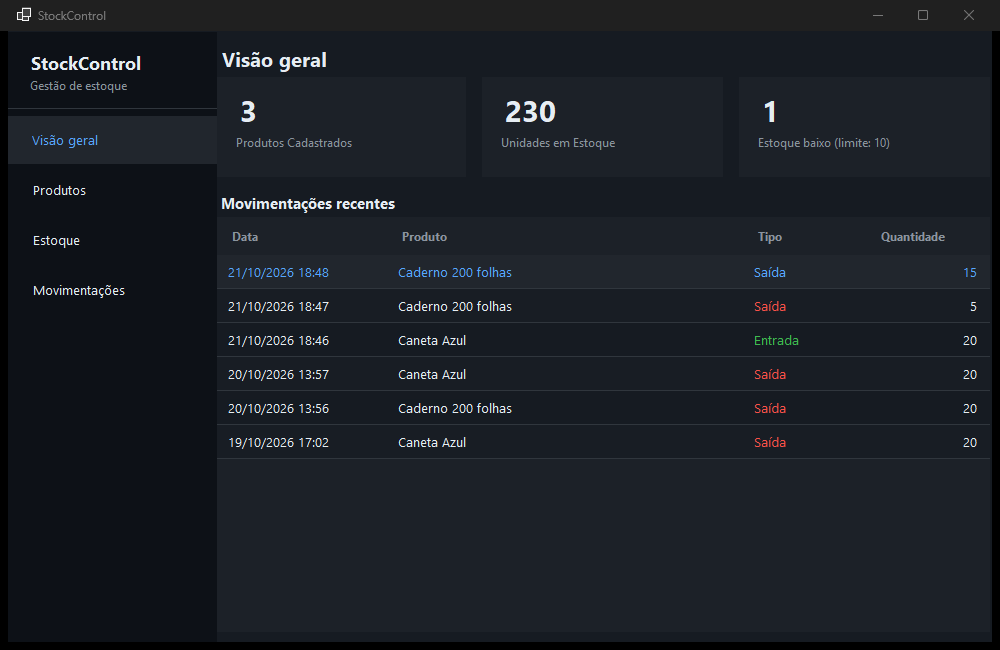
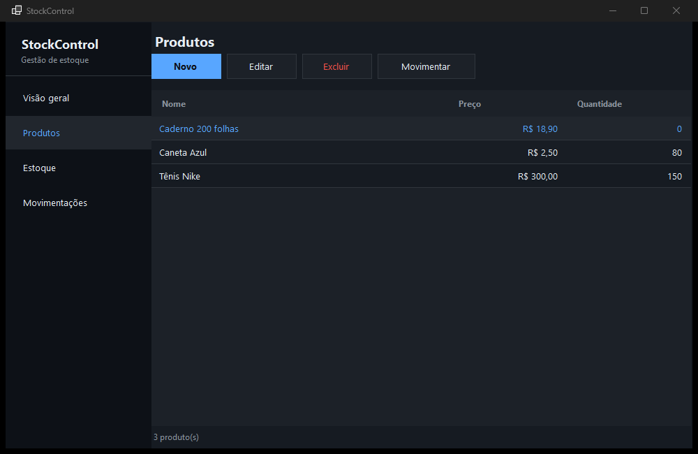
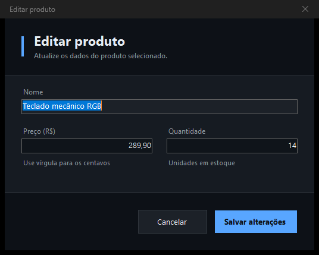
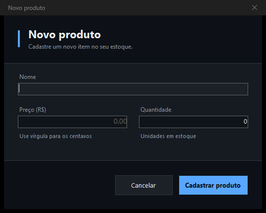
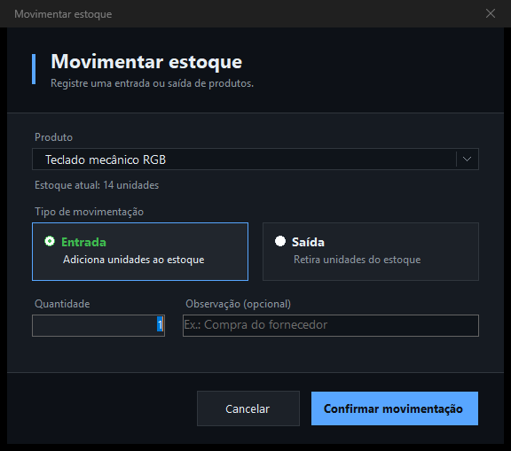
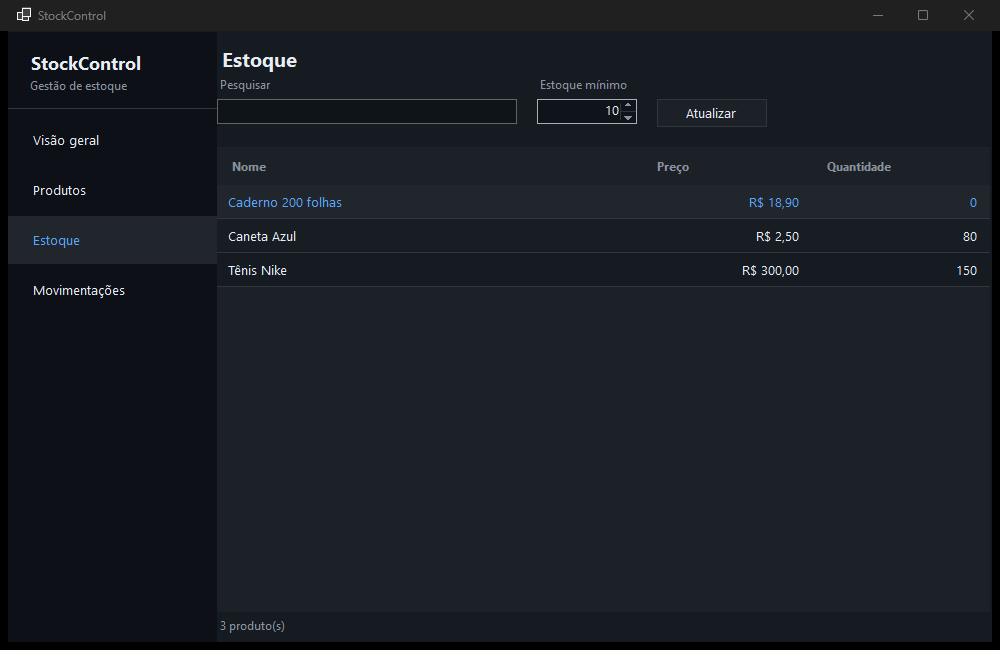
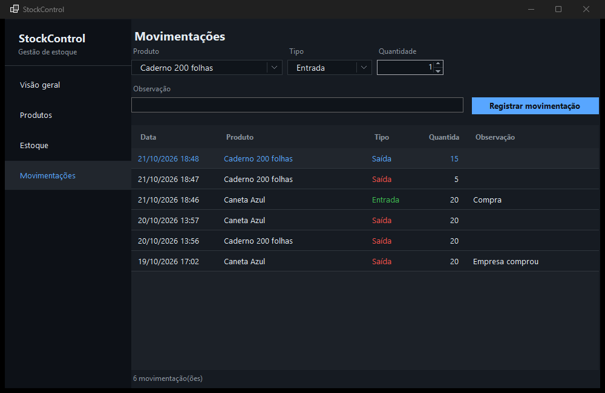

# StockControl

Sistema desktop para controle de estoque, desenvolvido em **C# com Windows Forms (.NET 10)** e **SQL Server**. Permite cadastrar produtos, registrar entradas e saídas, acompanhar o saldo e visualizar um resumo do estoque em um painel único.



## Funcionalidades

- **Visão geral** — total de produtos, unidades em estoque, alerta de estoque baixo e as movimentações mais recentes.
- **Produtos** — cadastro, edição e exclusão, com validação de nome, preço e quantidade.
- **Movimentações** — entrada e saída de unidades com observação opcional; o saldo é atualizado na mesma transação.
- **Estoque** — consulta com busca por nome e limite mínimo de estoque configurável na tela.
- **Histórico** — cada movimentação guarda produto, tipo, quantidade, data e observação.
- **Exclusão segura** — ao excluir um produto com histórico, o sistema avisa e só remove os dados após confirmação explícita.
- **Tema escuro** — interface consistente, com diálogos próprios e barra de título escura.

## Tecnologias

| Item | Versão / detalhe |
| --- | --- |
| Linguagem | C# |
| Framework | .NET 10 (`net10.0-windows`) |
| Interface | Windows Forms |
| Banco de dados | SQL Server |
| Driver | `Microsoft.Data.SqlClient` 7.1.1 |

## Requisitos

- Windows 10 ou 11
- [.NET SDK 10](https://dotnet.microsoft.com/download)
- SQL Server (Express, Developer ou instância local) com autenticação do Windows

## Como executar

### 1. Clone o repositório

```bash
git clone https://github.com/SEU-USUARIO/StockControl.git
cd StockControl
```

### 2. Crie o banco de dados

Abra o arquivo [`Banco de Dados.sql`](Banco%20de%20Dados.sql) no SQL Server Management Studio e execute, ou use o `sqlcmd`:

```powershell
sqlcmd -S . -E -C -i "Banco de Dados.sql"
```

O script cria o banco `StockControlDB`, as tabelas `Produtos` e `Movimentacoes` e alguns produtos de exemplo. Ele pode ser executado mais de uma vez sem duplicar dados.

### 3. Configure a conexão

A string de conexão é resolvida nesta ordem:

1. Variável de ambiente `STOCKCONTROL_CONNECTION`;
2. chave `ConnectionStrings:StockControl` do `appsettings.json` (copiado para a pasta de saída);
3. valor padrão local: `Server=.\;Database=StockControlDB;Trusted_Connection=True;TrustServerCertificate=True;`.

Para usar outra instância, defina a variável antes de rodar:

```powershell
$env:STOCKCONTROL_CONNECTION = "Server=.\SQLEXPRESS;Database=StockControlDB;Trusted_Connection=True;TrustServerCertificate=True;"
dotnet run --project StockControl.csproj
```

Ou edite o `appsettings.json`:

```json
{
  "ConnectionStrings": {
    "StockControl": "Server=.\\SQLEXPRESS;Database=StockControlDB;Trusted_Connection=True;TrustServerCertificate=True;"
  }
}
```

### 4. Execute

```bash
dotnet run --project StockControl.csproj
```

## Capturas

| Produtos | Editar produto |
| --- | --- |
|  |  |

| Novo produto | Movimentar estoque |
| --- | --- |
|  |  |

| Estoque | Movimentações |
| --- | --- |
|  |  |

## Estrutura do projeto

```
StockControl/
├── Data/                        Acesso ao SQL Server
│   ├── Conexao.cs               Resolução da string de conexão
│   ├── ProdutoRepositorio.cs    CRUD de produtos
│   ├── MovimentacaoRepositorio.cs
│   └── DashboardRepositorio.cs
├── Models/                      Entidades do domínio
│   ├── Produto.cs
│   ├── Movimentacao.cs
│   └── ResumoDashboard.cs
├── docs/screenshots/            Imagens usadas neste README
├── Form1.cs                     Janela principal e navegação
├── DashboardControl.cs          Painel de visão geral
├── ProdutosControl.cs           Tela de produtos
├── EstoqueControl.cs            Tela de estoque
├── MovimentacoesControl.cs      Tela de movimentações
├── ProdutoForm.cs               Diálogo de cadastro/edição
├── MovimentacaoForm.cs          Diálogo de entrada/saída
├── DialogoMensagem.cs           Diálogos escuros de aviso/erro/confirmação
├── Tema.cs                      Cores, fontes e estilos compartilhados
├── ComboBoxEscuro.cs            ComboBox com tema escuro
├── NumericUpDownEscuro.cs       NumericUpDown com tema escuro
├── ConfiguracaoEstoque.cs       Limite mínimo padrão de estoque
├── Banco de Dados.sql           Script de criação do banco
├── appsettings.json             String de conexão (opcional)
└── StockControl.csproj
```

## Banco de dados

**`dbo.Produtos`**

| Coluna | Tipo | Observação |
| --- | --- | --- |
| `Id` | `INT IDENTITY` | Chave primária |
| `Nome` | `NVARCHAR(150)` | Obrigatório |
| `Preco` | `DECIMAL(10,2)` | `>= 0` |
| `Quantidade` | `INT` | `>= 0` |

**`dbo.Movimentacoes`**

| Coluna | Tipo | Observação |
| --- | --- | --- |
| `Id` | `INT IDENTITY` | Chave primária |
| `ProdutoId` | `INT` | FK para `Produtos` |
| `Tipo` | `TINYINT` | `1` = Entrada, `2` = Saída |
| `Quantidade` | `INT` | `> 0` |
| `Data` | `DATETIME2` | Padrão `SYSDATETIME()` |
| `Observacao` | `NVARCHAR(200)` | Opcional |

## Regras de negócio

- Nome, preço e quantidade são validados antes de gravar; o preço aceita vírgula ou ponto como separador decimal (pt-BR).
- Uma **entrada** soma unidades ao saldo; uma **saída** subtrai, e só é concluída se houver saldo suficiente.
- O saldo e o registro da movimentação são gravados na **mesma transação** do banco.
- A exclusão de produto com histórico exige confirmação e remove produto e movimentações na **mesma transação**.

## Roteiro de teste manual

1. Cadastre um produto com preço `10,50` e quantidade `5`; confira o valor exibido na lista.
2. Edite o produto e altere o nome e a quantidade.
3. Registre uma **saída** de `10` unidades em um produto com saldo `5`: o sistema deve recusar com a mensagem de estoque insuficiente.
4. Registre uma **entrada** e uma **saída** válidas e confira o saldo e o histórico.
5. Exclua um produto **sem** movimentações.
6. Exclua um produto **com** movimentações: o diálogo deve avisar que o histórico será apagado; cancele e confirme que nada foi removido; repita confirmando.
7. Na tela de estoque, use a busca e altere o limite mínimo para destacar produtos com estoque baixo.

## Limitações conhecidas

- Aplicação exclusiva para **Windows** (Windows Forms e P/Invoke para a barra de título escura).
- Sem autenticação ou perfis de usuário: o acesso ao banco usa a conta do Windows.
- Sem testes automatizados; o roteiro acima cobre o fluxo principal manualmente.
- A exclusão de um produto remove também o seu histórico de movimentações, sempre mediante confirmação.

## Licença

Distribuído sob a licença MIT. Consulte [LICENSE](LICENSE).
